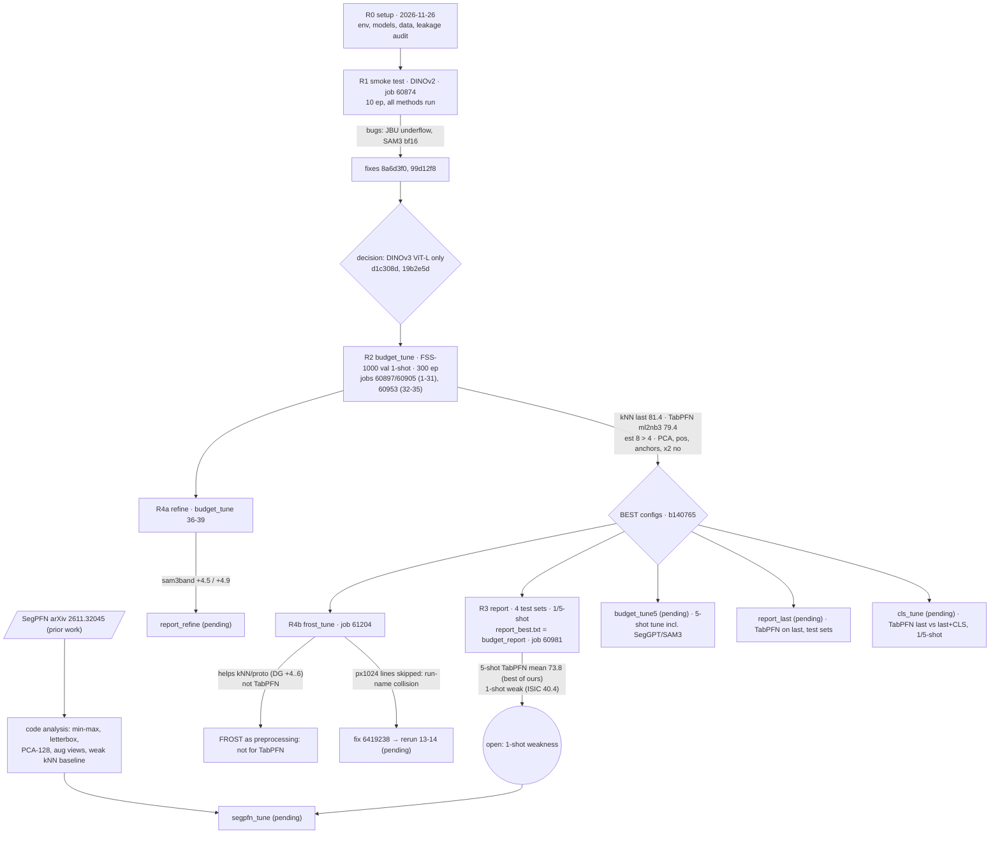

# Provenance: how every result came about

This file records **which experiment answered which question, with which code, and what we decided**.
Numbers live in `results/REGISTRY.md` (generated, never edited by hand):

```bash
python scripts/provenance.py          # results*/ -> results/REGISTRY.csv + results/REGISTRY.md
```

Every run writes `results/<run>/config.json["provenance"]` = git commit (+ dirty flag), sweep file, sweep line,
SLURM job, host, start time, argv (since commit `provenance`). Older runs are linked to their sweep line by
recomputing run names (`scripts/provenance.py`).

All numbers below: DINOv3 ViT‑L/16 at 512 px unless stated, mIoU (class-wise, PATNet convention), seed 0.

## Lineage



## Rounds

| Round | Date | Sweep / job | Question | Result | Decision / commit |
|---|---|---|---|---|---|
| R0 | 2026-11-26 | CPU node | data + models ready, leakage | all 5 models OK; 4 datasets; 1 true val/test duplicate (`crocodile/7` = `american_alligator/1`) | exclude from val (`c9632e2`) |
| R1 | 2026-11-26 | `smoke_gpu.sbatch`, 60874 | does every method run on the H200? | yes; oracle 95.3, SegGPT 81.5, kNN 69.1, TabPFN 58.9 (DINOv2, 10 ep) | JBU fix `8a6d3f0`, SAM3 bf16 fix `99d12f8`; **DINOv3 ViT‑L only** `d1c308d`/`19b2e5d` |
| R2 | 2026-11-26 | `budget_tune.txt` 1–35, 60897/60905/60953 | Q1 on FSS val 1‑shot; TabPFN settings | kNN last 81.4, TabPFN ml2nb3 79.4 (most robust over feature sets), est 4→8 +1.4, PCA‑768 −3.7, x2/pos no gain, anchors −4; SegGPT 84.6, SAM3 stitch 88.0 | `BEST` in `make_budget_sweeps.py` (`b140765`); logreg‑C name collision fixed (`b088e85`) |
| R3 | 2026-11-27 | `report_best.txt` (cluster copy of `budget_report.txt`), 60981 | test sets, 1/5‑shot | 5‑shot mean: TabPFN 73.8, SAM3 73.5, logreg 73.4, kNN 72.4; 1‑shot: SAM3 71.3, kNN 65.1, TabPFN 61.6. SegGPT 5‑shot improves except Deepglobe (genuine) | 1‑shot weakness is the open problem |
| R4a | 2026-11-27 | `budget_tune.txt` 36–39 | SAM3 refinement | TabPFN 79.4 → 82.8 (replace) → **83.8 (band)**; kNN 81.4 → 85.4 → **86.3** | `report_refine.txt` (`5358ac0`) |
| R4b | 2026-11-27 | `frost_tune.txt` 1–20, 61204 | FROST preprocessing for every learner | kNN/proto gain on Deepglobe (proto 5‑shot 59.4 ≈ RSRM/FROST); TabPFN ±0 (debias +0.5, whiten +1.1, flip −1.1) | not used for TabPFN; px1024 runs collided → `6419238` |
| ext | 2026-11-27 | — | prior work | **SegPFN** (2611.32045): DINOv3‑L + TabPFN‑3.5, PCA‑128, ≤1,024 ctx rows, aug views, min–max, CRF; weak kNN baseline | cite; differentiate (many-shot/large context, fair baselines, OOD) |
| R5 | pending | `segpfn_tune`, `report_refine`, `budget_tune5`, `frost_tune` 13–14, `report_last`, `cls_tune` | 1‑shot fix (min–max, letterbox 1024), refinement on test, 5‑shot tune, TabPFN‑last on test, CLS token | — | — |

## Sweep index

All generated by `scripts/make_budget_sweeps.py` (one section per file). Line numbers are stable: new runs are
only ever appended.

| File | Runs | Split | Purpose | Status |
|---|---|---|---|---|
| `budget_tune.txt` | 39 | FSS‑1000 val 1‑shot, 300 ep | Q1 feature sets × learners, TabPFN knobs, pos/anchors (32–35), SAM3 refine (36–39) | done |
| `budget_report.txt` | 56 | 4 test sets, 1/5‑shot | report with `BEST` | done (run as `report_best.txt`) |
| `frost_tune.txt` | 20 | FSS val 1/5‑shot, Deepglobe test | FROST preprocessing, ablation, px1024 (13–14) | done except 13–14 |
| `report_refine.txt` | 16 | 4 test sets | TabPFN/kNN + SAM3 band | pending |
| `budget_tune5.txt` | 15 | FSS val 5‑shot | 5‑shot version of the first tune | pending |
| `segpfn_tune.txt` | 10 | FSS val 1/5‑shot, ISIC test (diagnostic) | min–max, letterbox 1024 | pending |
| `report_last.txt` | 8 | 4 test sets | TabPFN on last-layer features (clean Q1 vs kNN last) | pending |
| `cls_tune.txt` | 4 | FSS val 1/5‑shot | TabPFN last vs last + CLS | pending |
| `archive_full_plan/stage*.txt` | — | — | original full plan (`scripts/make_sweeps.py`) | **never run**, archived |

Result folders: `results/` (all sweeps), `results_smoke/` (R1, DINOv2, 10 ep — pipeline check only),
`results_est/` (planned estimator job, superseded by `budget_tune`).

## Known pitfalls (keep in mind when reading results)

- Run names are the cache key (`--skip_done`). Anything that changes a result **must** be in `run_name()`.
  Fixed so far: logreg C / kNN k (`b088e85`), img_size (`6419238`). Still **not** in the name: `--limit`,
  `--episodes`, `--start` → never mix episode counts for the same configuration.
- Test sets are never used for selection. Deepglobe/ISIC runs in `frost_tune`/`segpfn_tune` evaluate fixed
  literature recipes and are labelled diagnostic.
- Protocol differences between papers are large (FROST Deepglobe 39.1 in its own paper vs 50.5 in SCoRe;
  FSS‑SAM3 ISIC 64.4 / 70.3 / 73.9 in SCoRe / SegPFN / ours). Compare only within one protocol.
